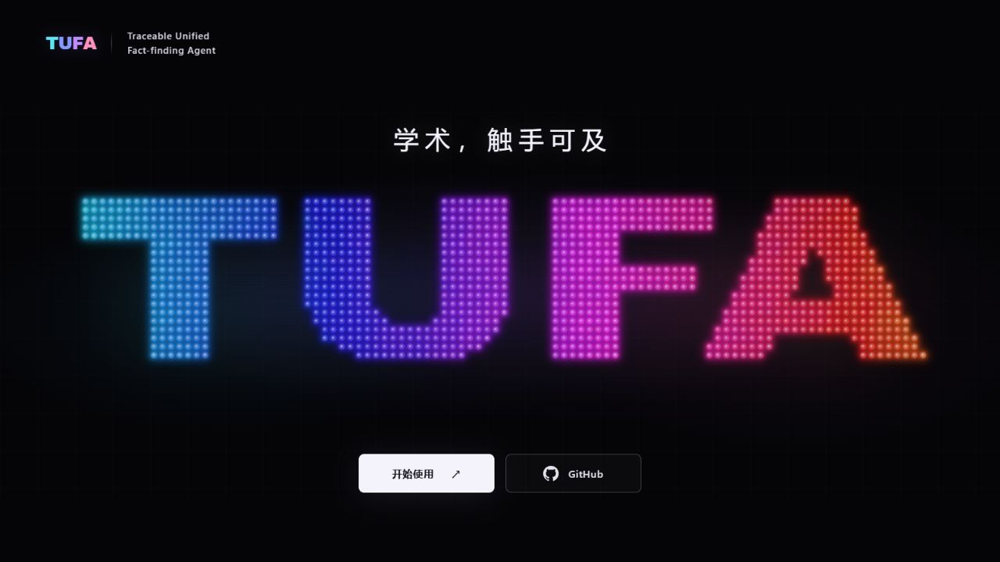
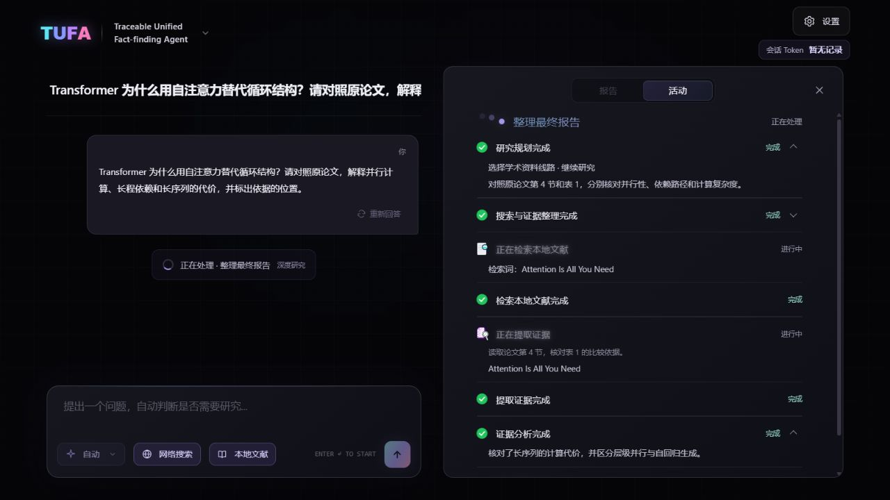

# Tufa Scholar

> [!NOTE]
> 你正在查看 benchmark 实验分支。评测工作台仅在此分支提供，面向科研流程开发和评测。日常科研可使用 [main 分支](https://github.com/iJA774/Tufa-Scholar/tree/main)。

**从科研问题到可回查的证据。**

TUFA（Traceable Unified Fact-finding Agent）是在本机运行的科研助手，适合需要查文献、做综述或核对论据的学生和研究人员。提出问题后，你可以跟随它的研究计划、检索和证据审查，在报告中沿着引用回到 PDF 页码、本地文档片段或来源网页。

[快速开始](#快速开始) · [使用示例](#使用示例) · [项目文档](#项目文档)

## 界面展示

| 启动页 | 深度研究工作区 | 报告与引用 |
| --- | --- | --- |
|  |  |  |

截图来自实际界面。研究活动使用下方 Transformer 案例的演示数据，报告截图展示另一次关于 AI Agent 研究方向的问答。

## 核心功能

- **跟进深度研究。** 查看研究计划、检索、原文阅读和证据审查。流程可以根据证据缺口补充检索，最后生成带引用的报告。
- **让自己的文献参与研究。** 导入 PDF，或批量预处理 PDF、DOCX 和 TXT。TUFA 会生成研究领域、标签和简短描述，研究时先浏览目录信息，再按需读取相关正文。
- **选择要查的来源。** 深度研究可以结合项目文献、OpenAlex 学术检索和网页搜索。提问时可以分别关掉联网检索或本地文献检索。
- **顺着引用核对证据。** 报告使用编号引用，按来源提供 PDF 页码、本地 Markdown 字符范围或网页链接。可下载 Markdown 报告和 CSV 证据表。

### Benchmark 评测

在「设置 → Benchmark 评测」打开工作台。可用 DeepResearch Bench 题库批量生成报告、运行 RACE 和 FACT 评分、比较历史批次并导出结果。

研究模型、Judge 和正文提取服务的调用可能额外计费。提交前可先选少量样本并设置预算。官方榜单成绩由榜单的提交与评测条件决定。本机配置和 CLI 用法见 [Benchmark 指南](docs/BENCHMARK.md)。

## 快速开始

### 安装

下面以 Windows PowerShell 为例。准备 Git、Python 3.13、uv、Node.js 22.14 和 pnpm 11.25.0。SQLite 随 Python 提供。

```powershell
git clone --branch benchmark https://github.com/iJA774/Tufa-Scholar.git
cd Tufa-Scholar
uv sync --locked
pnpm install --frozen-lockfile
```

### 配置与启动

在仓库根目录启动。3000 和 8000 端口需空闲，按 Ctrl+C 停止。

```powershell
.\start.ps1
```

1. 等待浏览器打开 [本机首页](http://127.0.0.1:3000)，点击「开始使用」。
2. 在「设置 → 服务与模型」填写 OpenAI 兼容服务的 Base URL、API Key 和默认模型 ID。深度研究需要模型服务支持结构化输出和原生函数调用。
3. 选择「深度研究」，提一个需要查证的问题。网页搜索默认使用 DuckDuckGo，可以在「设置 → 网页搜索」切换服务。文献可在「设置 → 本地文档」放入原文目录，再点击「预处理」。

数据默认保存在仓库的 `data/` 目录。模型调用及文档分类会向你配置的服务发送必要内容。设置优先级、手动启动和排障见 [开发指南](docs/DEVELOPMENT.md#运行与诊断)。导入与格式限制见 [本地文档指南](docs/DOCUMENTS.md)。

## 使用示例

> Transformer 为什么用自注意力替代循环结构？请对照原论文，解释并行计算、长程依赖和长序列的代价，并标出依据的位置。

1. 下载 [《Attention Is All You Need》会议版 PDF](https://papers.nips.cc/paper_files/paper/2017/file/3f5ee243547dee91fbd053c1c4a845aa-Paper.pdf)，放入原文目录并预处理。
2. 在同一项目选择「深度研究」，打开「本地文献」并关掉「网络搜索」，将研究范围限定在本地。提交问题后，可在「活动」查看研究计划、文献读取和审查。
3. 在「报告」核对编号引用。这个案例可以回到论文第 4 节和表 1（PDF 第 6 页）检查并行性、信息传递路径和计算复杂度，再下载报告与证据表。

报告示例：原论文表 1 给出的最大路径长度，自注意力层为 O(1)，循环层为 O(n)。可用报告中的编号找到论文和对应页码。

## 限制与路线图

- TUFA 面向本机单用户，快速开始以 Windows 为例。
- 扫描 PDF 需要先做 OCR，加密 PDF 需要先解密。复杂版式和动态网页可能提取不全。
- 引用可用于回查来源，报告结论仍需结合原文复核。模型与搜索服务的兼容性和结果质量因提供商而异。

OCR、语义检索和历史报告版本管理仍待实现。详见 [当前能力与限制](docs/STATUS.md#尚未实现或未验证)。

## 项目文档

| 我想了解 | 文档 |
| --- | --- |
| 文档导入、预处理和定位 | [本地文档指南](docs/DOCUMENTS.md) |
| 网页搜索与服务配置 | [网页搜索](docs/WEB_SEARCH.md) |
| 当前能力和已知限制 | [项目状态](docs/STATUS.md) |
| HTTP 接口和调用示例 | [API 指南](docs/API.md) |
| 工作流、来源范围和研究预算 | [架构](docs/ARCHITECTURE.md) |
| 本地开发、诊断与验证 | [开发指南](docs/DEVELOPMENT.md) · [仓库协作规则](AGENTS.md) |

研究面板的第三方来源及许可见 [前端说明](apps/web/README.md)。
