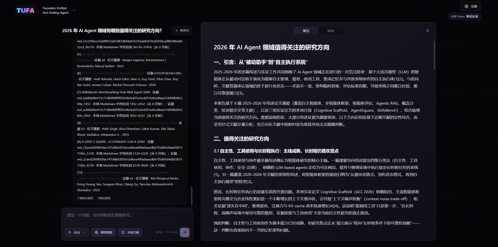

# Tufa Scholar

**从科研问题到可回查的证据。**

TUFA 是在本机运行的科研 Agent。用它查文献、做综述，或带上你自己的资料做专题研究。你可以看着它规划、检索和读原文，再顺着报告里的引用回到证据。

[快速开始](#快速开始) · [看一次研究](#使用示例) · [项目文档](#项目文档)

## 核心功能

- **看得到研究是怎么做的。** 在工作区跟进研究计划、文献检索和证据审查。有缺口时，TUFA 可以继续查资料。
- **让自己的资料参与研究。** 批量整理 PDF、DOCX 和 TXT，自动生成研究领域、标签和简介。TUFA 先看目录，再按需阅读相关正文。
- **按问题选来源。** 结合本地文献、OpenAlex 和网页搜索，也可以只查自己的资料。
- **从结论回到原文。** 用编号引用找到 PDF 页码、本地文档片段或来源网页。研究报告可导出为 Markdown，证据可导出为 CSV。

## 界面展示


### 深度研究工作区

[](assets/screenshots/research.jpg)

### 研究报告与引用

[](assets/screenshots/report.png)

## 快速开始

### 安装

准备 Git、Python 3.13、uv、Node.js 22.14 和 pnpm 11.25.0，然后在 Windows PowerShell 中运行以下命令。

```powershell
git clone https://github.com/iJA774/Tufa-Scholar.git
cd Tufa-Scholar
uv sync --locked
pnpm install --frozen-lockfile
```

### 配置与启动

在仓库根目录启动。启动器使用 3000 和 8000 端口。按 Ctrl+C 停止。

```powershell
.\start.ps1
```

1. 打开 [本机首页](http://127.0.0.1:3000)，点击「开始使用」。
2. 在「设置 → 服务与模型」填入 OpenAI 兼容服务的 Base URL、API Key 和模型 ID。深度研究请选择支持结构化输出和函数调用的模型。
3. 提问即可开始。想加入自己的资料时，从「设置 → 本地文档」打开原文目录，放入文件后点击「预处理」。

研究记录默认存放在本机 `data/` 目录。研究和文档分类会将所需内容发送给你配置的模型服务。手动启动、环境变量和排障见 [开发指南](docs/DEVELOPMENT.md#运行与诊断)。

## 使用示例

> 2026 年 AI Agent 领域有哪些值得关注的研究方向？

1. 打开「网络搜索」并提交问题。想直接进入研究流程，可以选择「深度研究」。
2. 在「活动」看 TUFA 如何从学术检索展开研究，再提取证据、整理主题。
3. 打开「报告」，沿着编号引用找到对应论文或本地文档片段。截图中的报告讨论了智能体的自主性、工具使用和长时程执行。你可以下载 Markdown 报告和 CSV 证据表，继续阅读或整理。

## 适用范围

TUFA 面向本机单人研究。文本型 PDF 可以直接读，扫描件先做 OCR，加密 PDF 先解密。更多格式支持和现阶段能力见 [本地文档指南](docs/DOCUMENTS.md#支持格式)与 [项目状态](docs/STATUS.md)。

## 项目文档

| 文档 | 内容 |
| --- | --- |
| [本地文档指南](docs/DOCUMENTS.md) | 导入、预处理和原文定位 |
| [网页搜索](docs/WEB_SEARCH.md) | 搜索引擎与服务配置 |
| [项目状态](docs/STATUS.md) | 已实现能力与后续方向 |
| [API 指南](docs/API.md) | HTTP 接口和调用示例 |
| [架构](docs/ARCHITECTURE.md) | 工作流、来源范围与研究预算 |
| [开发指南](docs/DEVELOPMENT.md) · [仓库协作规则](AGENTS.md) | 本地开发、诊断与验证 |

## 许可证

项目采用 [MIT 许可证](LICENSE)。研究面板的第三方来源及许可见 [前端说明](apps/web/README.md)。
