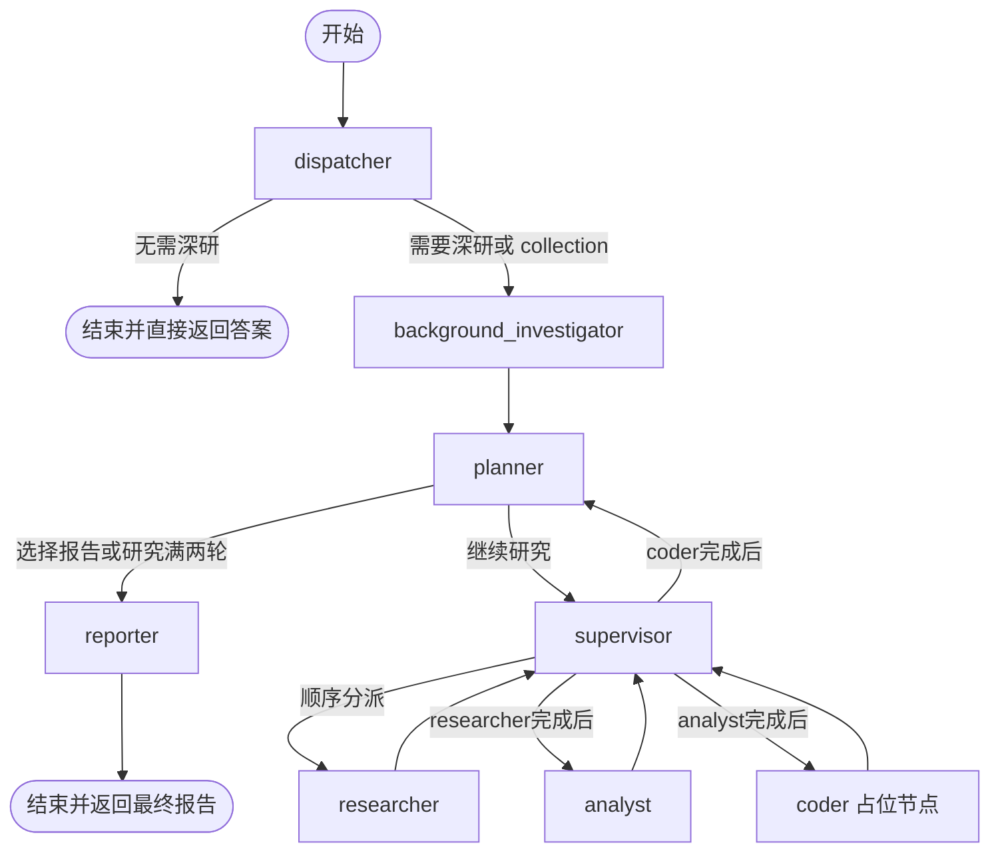

# 科研 Agent

`literature.py` 用一张 LangGraph 表达单图八节点科研问答。入口 `run(research, *, history, on_stage=None, on_subtask=None)` 返回最终 Markdown 和最终引用证据；节点不读取任务行、不查询对话历史、不写任务状态。worker 负责准备输入、持久化阶段和保存结果。

## 节点与流程

dispatcher 判断是否需要深度研究。简单请求由 dispatcher 直接回答并结束；collection 由代码强制进入研究流程，模型故障也按有限研究路径继续。其他来源遵守提交时的范围约束。

background_investigator 根据问题和可用来源选择背景方向，最多生成并执行三条真实搜索查询，再筛选检索到的候选并总结背景与缺口。搜索结果为空或失败时如实报告，不伪造候选或背景。planner 首轮规划必须启动研究；每次 researcher/analyst 往返后，planner 可沿原方向补查、切换到允许的 web 或 paper 来源，或交给 reporter。每次研究最多八个工具动作；搜索失败时可在预算内用改写查询重试。最多研究两轮，第二轮结束后始终进入 reporter。

supervisor 不调用模型，只依据完成节点将控制顺序交给 researcher、analyst、coder，再回到 planner。coder 是无模型的占位节点，不执行代码或伪装成提示词节点。reporter 汇总原问题、背景、研究初稿、审查和累计证据，不论证据是否完整都生成终稿；确定性校验失败或模型服务不可用时保留通过检查的内容并说明缺口。dispatcher 的直接回答不会进入 reporter。

## 模型节点、模板与输入

| 节点 | prompt ID | 责任与工具范围 |
|---|---|---|
| dispatcher | `runtime/dispatcher` | 判断是否深研；直接回答简单问题，不调用工具 |
| background_investigator | `literature/background_investigator` | 实搜并筛选背景；工具目录按允许来源提供 |
| planner | `literature/planner` | 拆解问题、给出一轮计划并选择 web/paper；无工具 |
| researcher | `literature/researcher` | 在当前来源范围内自主搜索、读取、取证并提交本轮初稿；最多八个工具动作 |
| analyst | `literature/analyst` | 深入审查问题覆盖、初稿与证据缺口；无工具 |
| reporter | `literature/reporter` | 综合至多两轮初稿与证据，始终生成最终报告；无工具 |

supervisor 和 coder 是确定性节点，不设置虚构 prompt ID。模型调用位于 `src/integrations/model.py`。Jinja2 仅渲染受信的六个 system 模板，使用 `StrictUndefined` 且关闭 autoescape；每次 HTTP 请求（包括格式纠错重试）注入当前北京时间和代码生成的 Pydantic `OUTPUT_SCHEMA`。工作流另提供 `node_role`、`search_mode`、节点权限过滤后的 `available_tools` 与本地文献文件名 `local_papers`。`CURRENT_TIME` 和 `OUTPUT_SCHEMA` 不能由上下文覆盖。问题、历史、网页、论文、候选、初稿和审查意见单独作为 user JSON 数据发送，不能进行二次模板求值；文件名也只是待处理数据。更多规则见 [提示词说明](../../docs/PROMPTS.md) 与 [模板维护规则](../prompts/AGENTS.md)。

每次模型 payload 只包含有界上下文：论文和网页候选分池，通常各最多 20 条（analyst 候选窗口最多 12 条），候选摘要或正文片段最多 1,600 字符；工作证据最多 18 条、正文合计最多 21,600 字符。planner 可看到项目文献文件名清单以判断现有范围，但文件名不代表已读取原文。工具目录由代码按节点和来源过滤；图层将候选 ID 映射为 registry 的真实参数，不能由模型构造项目范围或网页 URL。

## 候选与证据

论文与网页候选分别维护。跨查询按候选身份去重，使用不同查询的检索排名进行 RRF 合并；相同查询不会重复加权。候选 ID 由来源身份生成，缺乏稳定标识时才使用标题回退。每次取证最多处理六条候选，取证上限不截断进入候选池的搜索结果。

取证结果按来源、版本、页码或网页字符范围及文本去重，累计证据池跨研究轮保留。重复证据 ID 在单次运行中会被规范成唯一 ID；后续节点只引用输入证据中的 ID。页面与摘要的来源层级保持区分。reporter 的最终证据只包含通过代码引用、来源范围和数值检查的报告段落所使用的证据。

## 调用与验收

`research` 至少包含 `query`、`project_id`、`source`，可带 `paper_ids`、`model_name` 和 `reasoning_effort`；`history` 由调用方传入。collection 任务忽略外部 history，工具上下文使用任务提交时的论文快照。阶段回调按节点名通知；`on_subtask` 在 analyst 审查后交付本轮 findings、来源和 gap，调用方可选择保存。

检索、项目范围和证据定位分别见 [工具目录](../tools/README.md) 与 [文献业务](../literature/README.md)。模块回归与模拟 API/worker 实际入口见 [测试规则](../../tests/AGENTS.md) 和 [根 README 验收记录](../../README.md#验证)。模拟 HTTP 只能验证协议、提示词渲染和结构校验，不能证明真实模型回答质量。
