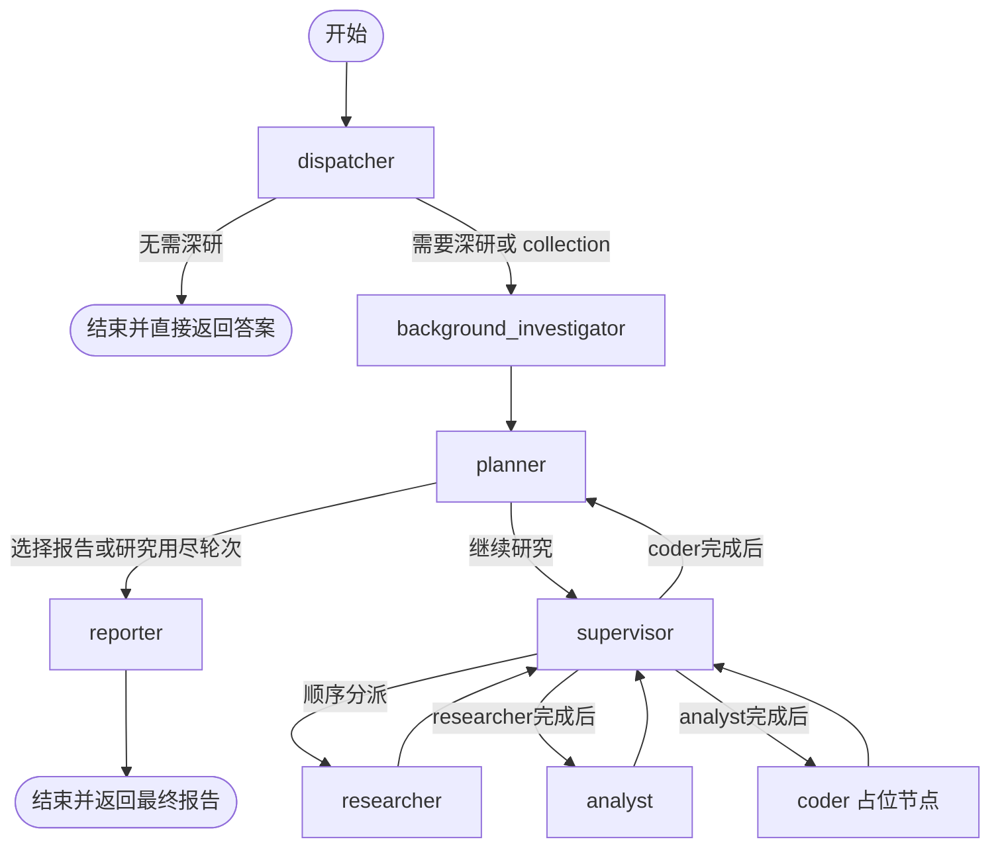

# 科研 Agent

`literature.py` 用一张 LangGraph 表达单图八节点科研问答。入口 `run(research, *, history, on_stage=None, on_subtask=None)` 返回最终 Markdown 和最终引用证据；节点不读取任务行、不查询对话历史、不写任务状态。worker 负责准备输入、持久化阶段和保存结果。

## 节点与流程

dispatcher 判断是否需要深度研究。简单请求由 dispatcher 直接回答并结束；collection 由代码强制进入研究流程，模型故障也按有限研究路径继续。其他来源遵守提交时的范围约束。

background_investigator 根据问题和可用来源选择背景方向，提出查询并实际筛选返回的候选，总结背景与缺口。搜索结果为空或失败时如实报告，不伪造候选或背景。planner 首轮规划必须启动研究；每次 researcher/analyst 往返后，planner 可沿原方向补查、切换到允许的 web 或 paper 来源，或交给 reporter。研究轮数、查询及工具动作额度见[架构预算表](../../docs/ARCHITECTURE.md#工作流预算)；搜索失败时可在剩余额度内用改写查询重试。

supervisor 按节点顺序调度 researcher、analyst、coder，再回到 planner。coder 是无模型的占位节点。reporter 汇总原问题、背景、研究初稿、审查和累计证据，自由组织 Markdown。终稿不可用时重新校验并交付最近一份有可用引用的草稿，并标明失败原因。没有合格草稿时说明证据不足及当前缺口。dispatcher 直接回答后结束工作流。

## 模型节点、模板与输入

| 节点 | prompt ID | 责任与工具范围 |
|---|---|---|
| dispatcher | `runtime/dispatcher` | 判断是否深研；直接回答简单问题，不调用工具 |
| background_investigator | `literature/background_investigator` | 提出背景查询；工作流按允许来源执行搜索并提供真实候选供筛选；无工具权限 |
| planner | `literature/planner` | 拆解问题、给出一轮计划并选择 web/paper；无工具 |
| researcher | `literature/researcher` | 在当前来源范围内自主搜索、读取、取证并提交本轮初稿；工具动作额度见[架构预算表](../../docs/ARCHITECTURE.md#工作流预算) |
| analyst | `literature/analyst` | 深入审查问题覆盖、初稿与证据缺口；无工具 |
| reporter | `literature/reporter` | 综合各轮初稿与证据，始终生成最终报告；无工具 |

模型调用位于 `src/integrations/model.py`。Jinja2 仅渲染受信的六个 system 模板，使用 `StrictUndefined`，每次 HTTP 请求注入当前北京时间。分流和背景调查使用 Pydantic `OUTPUT_SCHEMA`，researcher act 使用原生 Function Calling。Planner、Analyst、Researcher 初稿和 Reporter 输出 Markdown，Planner 与 Analyst 另附独立的调度控制块。问题、历史、网页、论文、候选、初稿、审查意见和本地文件名均作为 user JSON 数据发送。更多规则见 [提示词说明](../../docs/PROMPTS.md) 与 [模板维护规则](../prompts/AGENTS.md)。

模型请求按阶段裁剪。背景筛选接收检索候选摘要；planner 和 reporter 接收筛选摘要、缺口及候选 ID，不接收重复的候选正文。researcher act 每轮仅接收当前来源的短候选预览、证据预览、少量最近工具反馈和筛选候选 ID；结束时单独调用 draft 并传入所需证据，以保持证据引用校验能力。各阶段候选及证据条数、文本和上下文预算见[架构预算表](../../docs/ARCHITECTURE.md#工作流预算)。连续两次搜索失败或网页正文连续两次读取失败会提前结束当轮检索；同一轮会跳过此前读取失败的相同候选与字符区间，保留已有证据并继续生成初稿和报告。成功的后续工具调用会重置连续失败计数，分页偏移变化仍可读取。planner 可看到项目文献文件名清单以判断现有范围，但文件名不代表已读取原文。工具目录由代码按节点和来源过滤；图层将候选 ID 映射为 registry 的真实参数，不能由模型构造项目范围或网页 URL。

## 候选与证据

论文与网页候选分别维护。跨查询按候选身份去重，使用不同查询的检索排名进行 RRF 合并；相同查询不会重复加权。候选 ID 由来源身份生成，缺乏稳定标识时才使用标题回退。单次取证动作候选数及模型输入候选预览上限见[架构预算表](../../docs/ARCHITECTURE.md#工作流预算)；取证上限不截断进入候选池的搜索结果。

取证结果按来源、版本、页码或网页字符范围及文本去重，累计证据池跨研究轮保留。重复证据 ID 在单次运行中会被规范成唯一 ID；后续节点只引用输入证据中的 ID。页面与摘要的来源层级保持区分。reporter 的最终证据只包含通过代码引用、来源范围和数值检查的报告段落所使用的证据。

## 调用与验收

`research` 至少包含 `query`、`project_id`、`source`，可带 `paper_ids`、`model_name` 和 `reasoning_effort`；`history` 由调用方传入。collection 任务忽略外部 history，工具上下文使用任务提交时的论文快照。阶段回调按节点名通知；`on_subtask` 在 analyst 审查后交付本轮 findings、来源和 gap，调用方可选择保存。

检索、项目范围和证据定位分别见 [工具目录](../tools/README.md) 与 [文献业务](../literature/README.md)。模块回归与模拟 API/worker 实际入口见 [测试规则](../../tests/AGENTS.md) 和[根 README 验证命令](../../README.md#验证)。模拟 HTTP 只能验证协议、提示词渲染和结构校验，不能证明真实模型回答质量。
